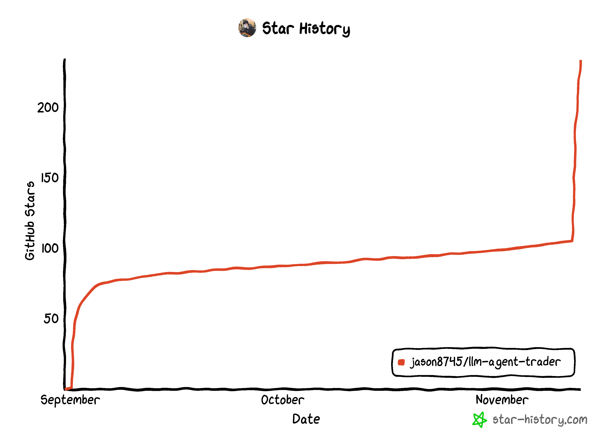
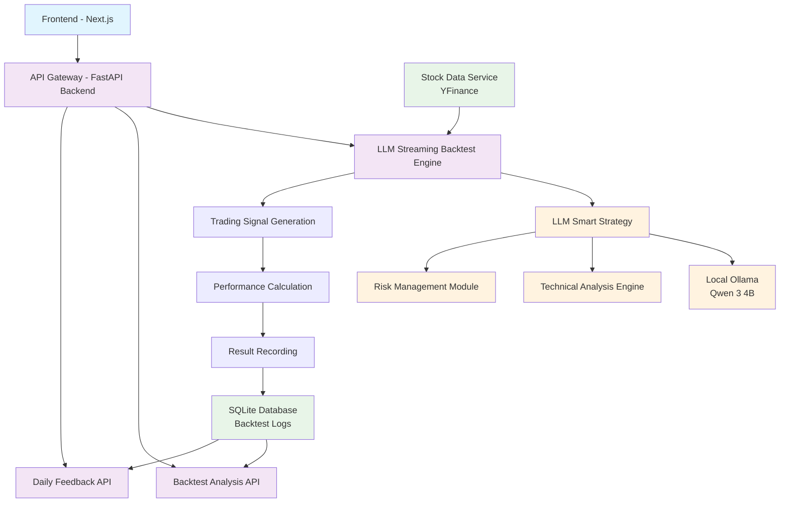

# LLM Agent Trader



Stock trading backtesting system using local Qwen 3 inference through Ollama.
[Read the English interface guide](docs/interface-guide.md) for backtest controls, decision logs, charts, and daily strategy discussions.

To try responses from a work computer using only GitHub, open **Actions → Ask the Trader → Run workflow**. Enter a question and read the answer in the run summary. See [GitHub response testing](docs/github-response-test.md) for the sample-trader and free-form modes.

The interface, prompts, explanations, logs, comments, and project documentation use English. The original uploaded ZIP remains an unchanged upstream archive.

Backtests follow enforced stages: **ACQUIRE → PREPARE → ANALYZE → SIMULATE → REVIEW → REPORT**. Each gate validates and saves its handoff before the next stage starts. The dashboard shows stage status, evidence, and **Stop after stage**. See the [stage gate guide](docs/stage-gates.md) for completion criteria and resource settings.

Model prompts now use [chunked evidence and tiered memory](docs/memory-and-chunking.md): immutable originals on disk, recent decision episodes, and a bounded current working state.

## System Architecture



## Quick Start

### Prerequisites
- **Ollama** running locally with `qwen3:4b` installed. The application uses your existing Ollama installation.
- **macOS/Linux**: Native support for `make` commands
- **Windows**: May require additional setup (WSL, Git Bash, or make utility installation)

### Install Dependencies

```bash
make install
```

### Local AI Setup

If your existing Ollama service is running and `qwen3:4b` is installed, you can use it immediately. Otherwise, start Ollama and download the model:

```bash
ollama serve             # Only if Ollama is not already running
```

In another terminal:

```bash
ollama pull qwen3:4b     # Only if the model is not already installed
ollama list
```

Copy the environment template:
```bash
cp .env.example .env
```

The default configuration is:
```env
OLLAMA_BASE_URL=http://127.0.0.1:11434
OLLAMA_MODEL=qwen3:4b
OLLAMA_NUM_THREAD=4
OLLAMA_NUM_CTX=8192
OLLAMA_KEEP_ALIVE=30m
OLLAMA_THINK=false
OLLAMA_TIMEOUT_SECONDS=0
```

Change `OLLAMA_MODEL` to the exact installed tag if you use a different Qwen 3 build. No cloud credentials are required, and old provider API keys do not select a different provider.

Trading decisions, retrospective analysis, and daily feedback all use this local client. Model requests and pipeline stages share the installation's heavy-work resource slot. Trading decisions use Ollama's JSON output mode; feedback and reviews use English text. `OLLAMA_THINK=false` selects direct answers so thinking does not consume the existing output-token budgets. Thinking is configurable, but longer thinking may require larger response budgets in the calling feature.

`OLLAMA_TIMEOUT_SECONDS=0` allows CPU inference to finish without a read deadline. Set a positive value if you want a read timeout. Ollama connection failures still time out after five seconds. Market-data downloads still require an internet connection.

### Development Mode
```bash
make run
```

**🎉 Success!** After setup, open your browser and navigate to:
**http://localhost:3000** to access the web application

### Other Commands
```bash
make stop     # Stop all services
make test     # Run tests
make clean    # Clean cache files
make format   # Format code
```

The automated local-AI tests use mocked Ollama responses and require neither a model download nor API credentials:

```bash
uv run pytest tests -q
```

Ollama API references: [chat](https://docs.ollama.com/api/chat), [structured output](https://docs.ollama.com/capabilities/structured-outputs), and [thinking](https://docs.ollama.com/capabilities/thinking).

### Windows Users
If you encounter issues with `make` commands on Windows, consider:
- **WSL (Windows Subsystem for Linux)**: Recommended approach
- **Git Bash**: Included with Git for Windows
- **Make for Windows**: Install GNU Make utility
