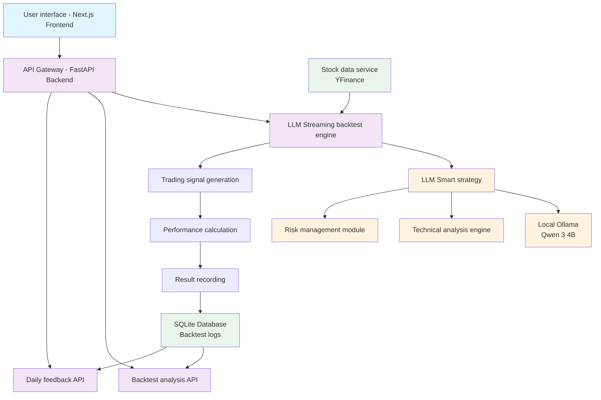
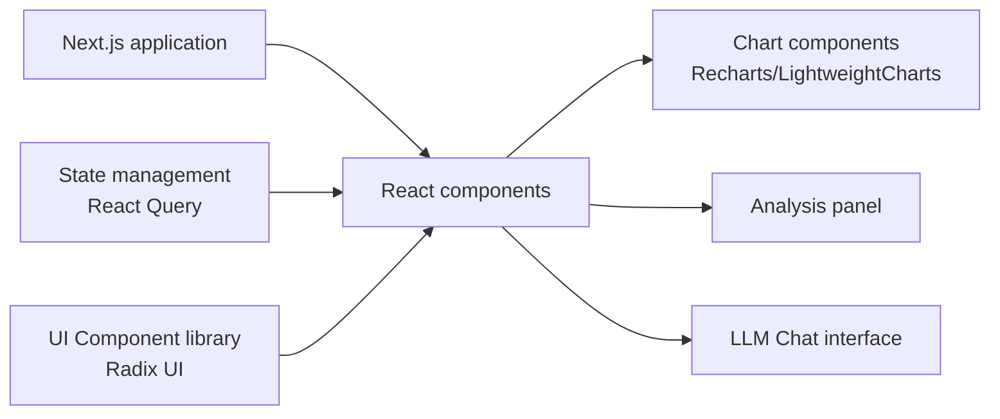
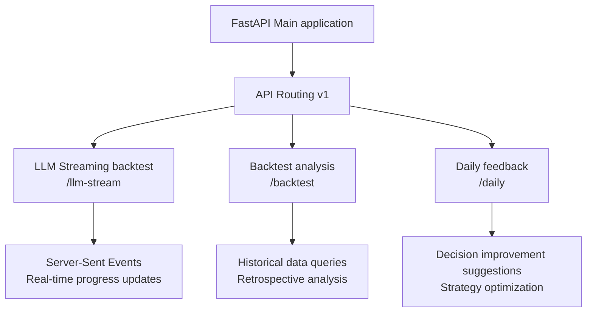
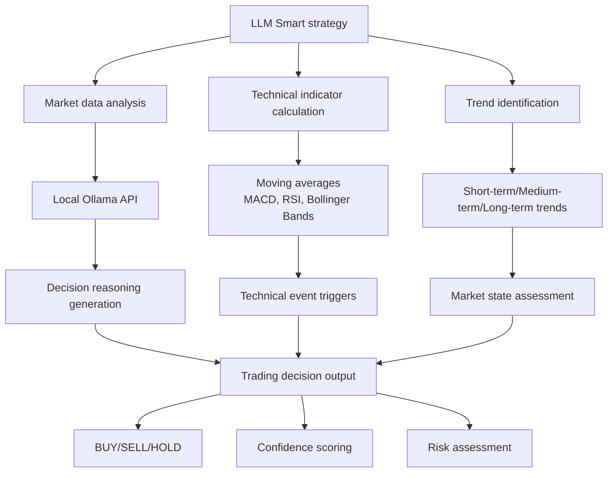
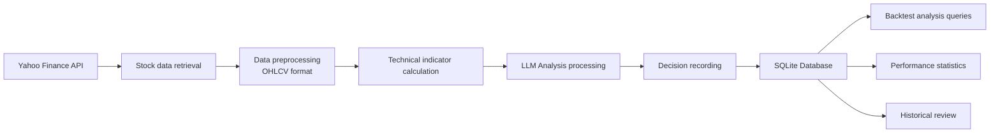
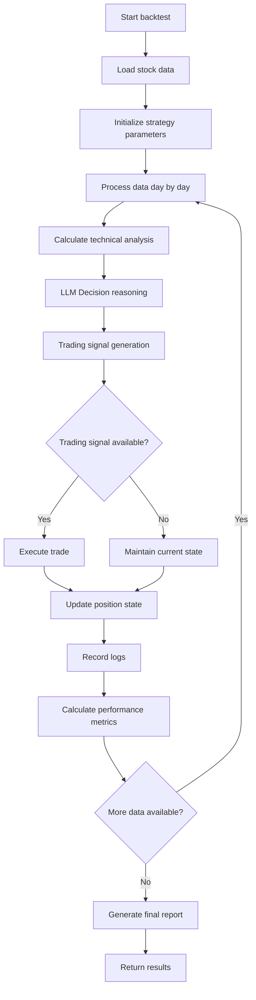

# LLM Agent Trader: System Architecture

## System overview
LLM Agent Trader is an AI-based stock trading backtesting system that integrates large language models (LLMs) for trading decision analysis.

## High-level system flowchart

## Core concepts

### LLM Streaming backtest engine vs Backtest engine
- **LLM Streaming backtest engine**: is the coordination layer for the backtesting system, responsible for: 
  - Receiving frontend requests and initializing backtests
  - Providing real-time progress updates using Server-Sent Events
  - Coordinating data retrieval, strategy execution, and result processing
  - Managing backtest sessions and state

- **Backtest engine**: is the core computation engine, focused on: 
  - Executing backtest logic and trading simulations
  - processing LLM trading signals generated by the strategy
  - Calculating performance and risk metrics
  - Maintaining positions and managing funds

The **streaming backtest engine** coordinates the workflow; the **backtest engine** performs the calculations and simulates trades.

## Detailed system architecture

### 1. Frontend layer (Frontend)

### 2. Backend API layer

### 3. LLM Strategy engine

### 4. Data flow

### 5. Backtest execution flow

## Core functional modules

### 1. LLM Decision engine
- **Input**: Market data, Technical indicators, Historical trends
- **Processing**: Local Qwen 3 reasoning through Ollama
- **Output**: Trading decisions, Confidence, Reasoning process

### 2. Technical analysis module
- **Moving averages**: SMA, EMA Crossover strategy
- **Momentum indicators**: RSI, MACD Signal
- **Volatility indicators**: Bollinger Band breakouts
- **Trend identification**: Multi-timeframe analysis

### 3. Risk management
- **Stop-loss mechanism**: Fixed-percentage stop loss
- **Take-profit settings**: Lock in target profits
- **Position control**: Maximum position allocation limit
- **Money management**: Dynamic capital allocation

### 4. Data persistence
- **SQLite Database**: Lightweight local storage
- **Logging**: Daily trading decisions and analysis
- **Performance tracking**: Cumulative returns and risk metrics
- **Event recording**: Technical events and trigger conditions

## Technology stack

### Frontend technologies
- **Framework**: Next.js 15.4.4 (React 19)
- **Styles**: Tailwind CSS 4.0
- **Charts**: Recharts, Lightweight Charts
- **State management**: TanStack React Query
- **UI components**: Radix UI

### Backend technologies
- **API Framework**: FastAPI (Python)
- **Database**: SQLite
- **LLM Integration**: Local Ollama API
- **Data source**: Yahoo Finance (yfinance)

### Development and operations
- **Development environment**: Python Virtual environment + Node.js
- **Version control**: Git
- **Dependency management**: uv (Python), npm (Node.js)

## System features

1. **Real-time streaming backtests**: Providing real-time progress updates using Server-Sent Events
2. **Intelligent decision analysis**: Uses local Qwen 3 for in-depth market analysis
3. **Interactive feedback**: Supports user feedback and improvement suggestions for historical decisions
4. **Comprehensive technical analysis**: Multidimensional technical indicators and trend identification
5. **Historical data analysis**: Supports complex backtest queries and retrospective analysis

## Extensible design

- **Modular architecture**: Independent functional modules, Easy to extend
- **API Version control**: Supports multiple versions of API side by side
- **Pluggable strategies**: Supports multiple trading strategies in parallel
- **Multiple data sources**: Can be extended to support additional financial data providers
- **Flexible deployment**: Supports local development and cloud deployment

## Local Model Integration

All AI features share the native Ollama chat client in `backend/app/llm/client.py`. The default model is `qwen3:4b` at `http://127.0.0.1:11434`. No cloud model SDKs or model API keys are required.

The client maintains the application's `response.content` interface. Trading decisions request JSON output; daily feedback and retrospective reviews request English prose. Async API handlers offload local inference to a worker thread. A shared host lock serializes heavy pipeline stages and inference across backend processes in the same installation.

The default context is 8192 tokens, inference uses four threads, and the model stays loaded for 30 minutes after use. Qwen's direct-answer mode is the default; thinking is configurable. The read timeout defaults to unlimited, while connection failures have a five-second timeout. These settings are documented in `.env.example`.

## Controller-Owned Stages

The streaming API and backtest engine use the same stage controller: ACQUIRE → PREPARE → ANALYZE → SIMULATE → REVIEW → REPORT. Each stage validates and saves a content-hashed handoff before the controller advances. Failed gates block later work. Model calls belong to ANALYZE, and data downloads belong to ACQUIRE; trend analysis uses the acquired snapshot.

The dashboard displays live gate status and can reload saved status and completed reports. Stop requests take effect at a stage boundary. Numerical work defaults to four threads, with one heavy stage or on-demand AI request holding the shared host resource slot at a time. See [the stage gate guide](docs/stage-gates.md) for the artifact checks and API.
